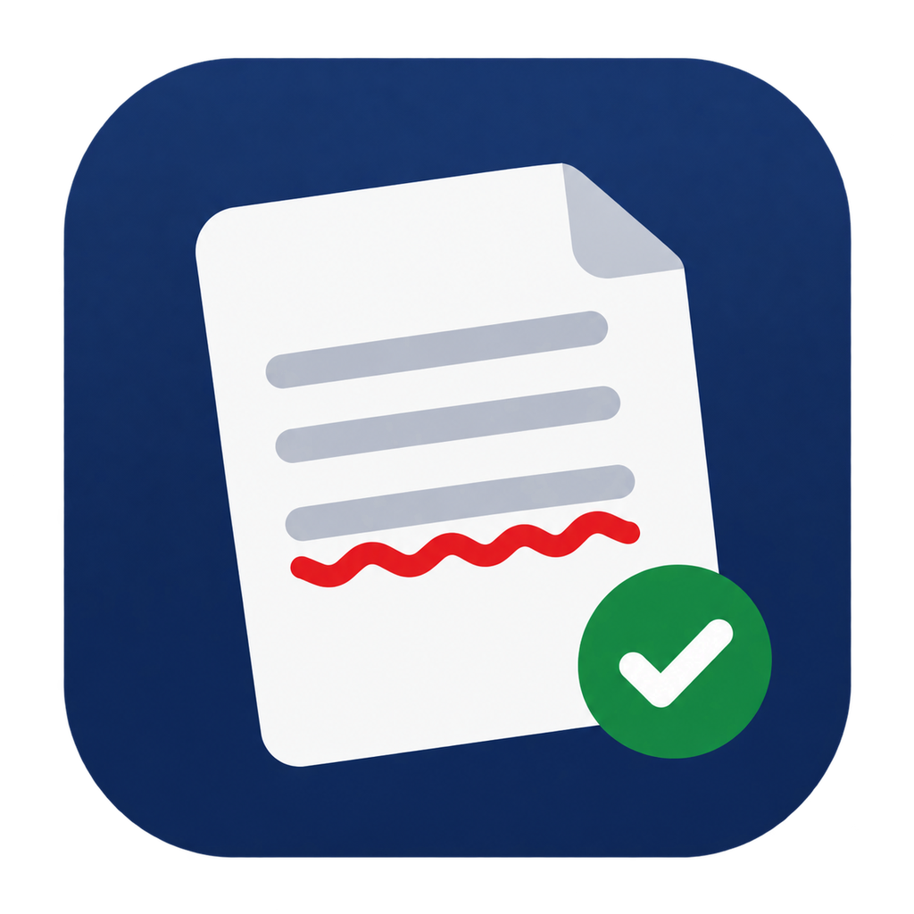
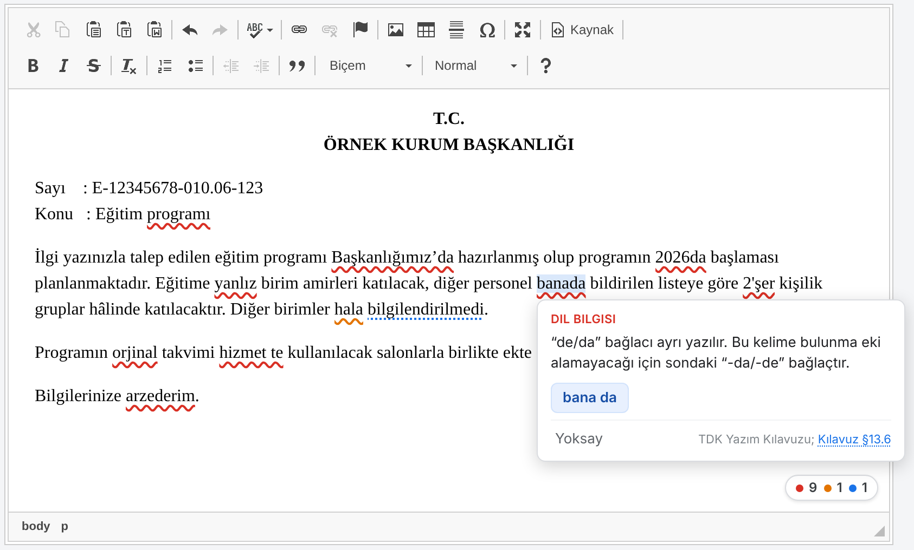
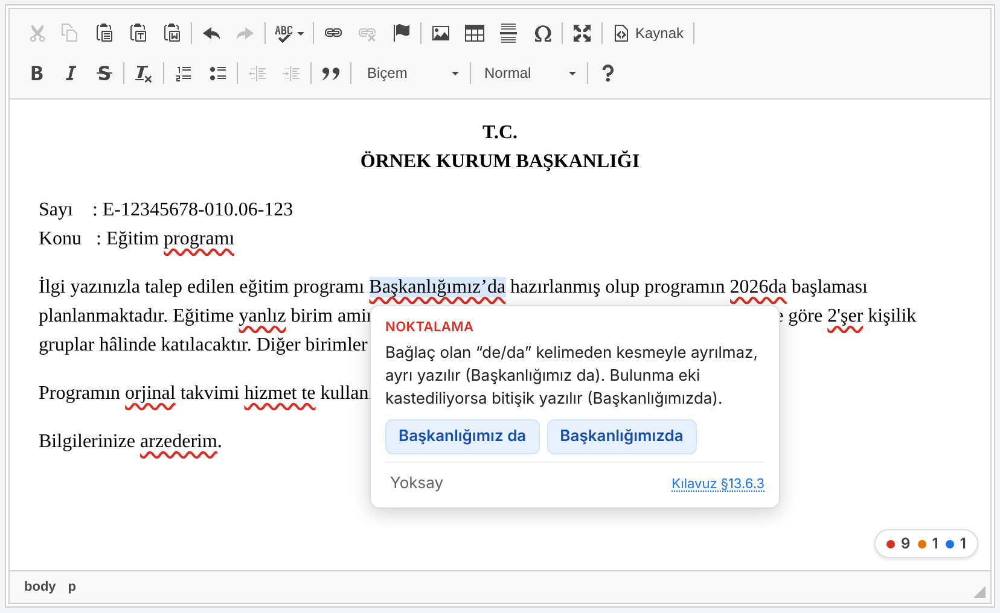
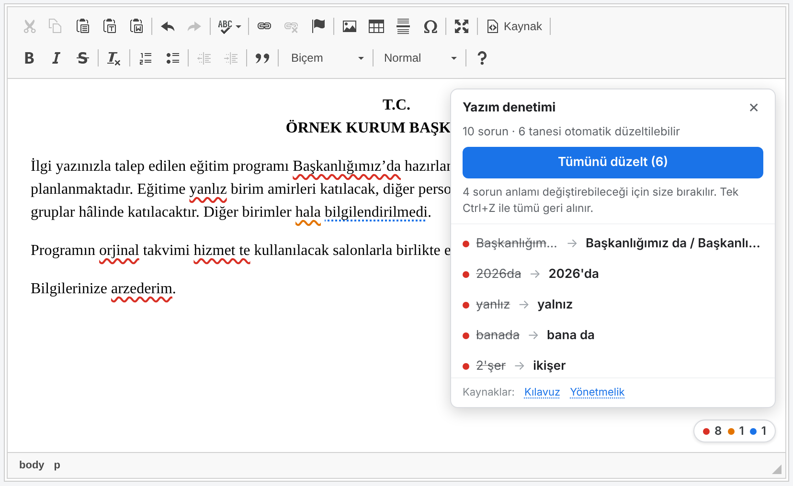

<div align="center">



# EBYS Yazım Denetimi

**Resmî yazıları EBYS'de yazarken Türkçe yazım, noktalama ve resmî yazışma kurallarını denetleyen Chrome eklentisi.**

Tamamen yerel çalışır · Hiçbir izin istemez · Metin hiçbir yere gönderilmez

**[Deneme sayfası](https://biyonik.github.io/ebys-yazim-denetimi/demo/)** · [Kurulum](#kurulum) · [Gizlilik](https://biyonik.github.io/ebys-yazim-denetimi/gizlilik.html)

[](https://github.com/biyonik/ebys-yazim-denetimi/actions/workflows/ci.yml)
[](LICENSE)




</div>

---

## Neden?

Resmî yazının kuralları üç ayrı belgeye dağılmış durumda: TDK Yazım Kılavuzu, Resmî Yazışma Yönetmeliği ve
Cumhurbaşkanlığının Resmî Yazışma Kuralları Kılavuzu. Hata çoğu zaman yazarken değil, imza aşamasında, hatta
yazı muhataba gittikten sonra fark ediliyor.

Bu eklenti üç kaynağı **yazarken** uygular. Hatanın altını çizer, doğrusunu önerir ve her uyarının hangi
kurala dayandığını gösterir. Dayanağa tıklayınca ilgili belge doğru sayfasında açılır.

## Neleri denetler?

| Alan | Örnekler |
|---|---|
| **Yazım** | ~35 bin kök + Türkçe ek dizimi: `yapilacak → yapılacak`, `orjinal → orijinal`, `kitabıda → kitabı da` |
| **De/da, ki, mi** | `banada → bana da`, `hizmet te → hizmet de`, `Başkanlığımız’da → Başkanlığımız da / Başkanlığımızda` |
| **Kesme işareti** | `Ahmetin → Ahmet’in`, `3de → 3’te`, `Valiliği’ne → Valiliğine`, `TDK’dan → TDK’den`, `17 Aralıkta → 17 Aralık’ta` |
| **Noktalama** | `, ve` · `de,` · şart ekinden sonra virgül · `% 25 → %25` · noktalama öncesi/sonrası boşluk |
| **Birleşik yazım** | `arzederim → arz ederim`, `kayıt edildi → kaydedildi`, `baş savcı → başsavcı`, `önyargı → ön yargı` |
| **Sayılar ve kısaltmalar** | `2’şer → ikişer`, `ikiyüz → iki yüz`, `1500000 TL → 1.500.000 TL`, `T.B.M.M. → TBMM` |
| **Resmî Yazışma Yönetmeliği** | Konu, Sayı, İlgi ve Ek biçimi; harfle sıralama (c, ç, d…); “arz ve rica”; GÜNLÜDÜR/ACELE; “a.” ve “V.”; paragraflar arasında boş satır |
| **Resmî Yazışma Kuralları Kılavuzu** | Muhatap yazımı, “tarihli ve … sayılı” kalıbı, kişisel anlatım (*planladık → planlanmıştır*), anlatım bozuklukları, tekit yazısı, “sık yanlış kullanılan kelimeler” tablosunun tamamı |

Ayrıntılı kural kataloğu: [docs/MIMARI.md](docs/MIMARI.md#7-kural-katalo%C4%9Fu)

<table>
<tr>
<td width="50%"><br><sub>Bağlama bağlı durumda iki seçenek; dayanağa tıklayınca Kılavuz’un ilgili sayfası açılır.</sub></td>
<td width="50%"><br><sub>Sorun paneli: <b>Tümünü düzelt</b> yalnızca tek doğru cevabı olan sorunları düzeltir.</sub></td>
</tr>
</table>

## Nasıl kullanılır?

- Altı **kırmızı** dalgalı çizgi **hata**, **turuncu** **kontrol edin** (bağlama bağlı), **mavi** noktalı **öneri** demektir.
- İşaretli kelimeye tıklayın: öneriyi seçin ya da **Yoksay**’a basın. Balonun sağ altındaki dayanak
  (“Kılavuz §13.6.3”, “Yönetmelik m.16(4)”) tıklanabilir.
- Editörün sağ altındaki rozet **sorun panelini** açar. **Tümünü düzelt** anlamı değiştirebilecek
  sorunlara (*bende / ben de*, *hala / hâlâ*) hiçbir zaman dokunmaz.
- Her düzeltme, toplu düzeltme dahil, CKEditor’ün geri al geçmişine **tek adım** olarak girer (Ctrl+Z).
- Belgenin biçimine (kalın, italik, tablo) dokunulmaz; kaydedilen evrakta eklentiden iz kalmaz.

## Gizlilik ve güvenlik

Kamu kurumlarında kullanılan bir eklentide en önemli soru “metnim nereye gidiyor?” sorusu. Cevap: **hiçbir yere.**

- **İzin yok.** `manifest.json` içinde `permissions: []`. Eklenti yalnızca yapılandırılan EBYS adresinde çalışır.
- **Ağ erişimi yok, makine tarafından doğrulanır.** Derleme betiği paketlenmiş kodda `fetch`, `XMLHttpRequest`,
  `WebSocket`, `sendBeacon` vb. bulursa derlemeyi durdurur. Uçtan uca test de dış ağ isteği olmadığını denetler.
- **Sözlük ve dayanak belgeler eklentinin içinde.** Uzak sunucu, telemetri, analitik yok.
- **Sayfaya köprü metin taşımaz.** CKEditor API’sine erişen küçük köprü yalnızca komut adı alır (geri al anlık
  görüntüsü, kaydet); belge metni sayfanın JavaScript ortamına eklenti aracılığıyla hiç çıkmaz.
- **Belgeye dokunmaz.** İşaretleme CSS Custom Highlight API ile yapılır; editörün DOM’una düğüm eklenmez.

## Kurulum

### Hazır paket (MEB EBYS)

[Sürümler](https://github.com/biyonik/ebys-yazim-denetimi/releases/latest) sayfasındaki
`ebys-yazim-denetimi-vX.Y.Z-meb.zip` dosyası `https://ebys.meb.gov.tr` için derlenmiştir.

1. Zip dosyasını indirip bir klasöre çıkarın (klasörü silmeyin; Chrome eklentiyi oradan çalıştırır).
2. Chrome adres çubuğuna `chrome://extensions` yazın, sağ üstten **Geliştirici modu**nu açın.
3. **Paketlenmemiş öğe yükle**’ye basın ve çıkardığınız `ebys-yazim-denetimi-…-meb` klasörünü seçin.
4. EBYS’de bir evrak açın: editörün sağ altında “✓ Yazım denetimi” rozeti görünür.

Güncellemek için yeni sürümün klasörünü aynı yere çıkarıp `chrome://extensions` sayfasında eklentinin
⟳ (yeniden yükle) düğmesine basmanız yeterlidir. Zip’in bütünlüğünü sürümdeki `.sha256` dosyasıyla doğrulayabilirsiniz.

> Kurum bilgisayarlarında **Geliştirici modu** politika ile kapatılmış olabilir. Bu durumda eklentinin
> BT birimi tarafından `ExtensionInstallForcelist` politikasıyla dağıtılması gerekir; eklenti izin istemediği
> ve ağa çıkmadığı için güvenlik incelemesi kısadır, kaynak kodu bu depodadır.

### Başka bir kurum için derleme

[Node.js](https://nodejs.org) 22.18 veya üstü gerekir.

```bash
git clone https://github.com/biyonik/ebys-yazim-denetimi.git
cd ebys-yazim-denetimi
npm install
```

`ebys.config.json` dosyasındaki adresi kendi EBYS adresinizle değiştirin:

```json
{
  "origins": ["https://ebys.kurumunuz.gov.tr/*"],
  "devOrigins": ["http://localhost/*", "http://127.0.0.1/*"]
}
```

```bash
npm run build
```

Ardından yukarıdaki 2. ve 3. adımlarla `dist/` klasörünü yükleyin.

## Nasıl çalışır?

```
EBYS sayfası
 └─ CKEditor 4 (iframe)
     ├─ içerik betiği ──► TextIndex: DOM ↔ düz metin eşlemesi
     │                     └─► çekirdek (DOM bilmez): tokenizer → kurallar → çakışma çözümü
     │                          ├─ biçimbilimsel çözümleyici (kök + ek dizimi + ses olayları)
     │                          ├─ TDK kuralları · Yönetmelik · Kılavuz
     │                          └─► sorunlar ──► Highlight API ile işaretleme, balon, panel
     └─ MAIN world köprüsü ──► CKEditor API: tek adımlık geri al, gizli alan eşitleme
arka plan ──► dayanak PDF’ini ilgili sayfada açar (yalnızca {belge, sayfa} alır)
```

- **Çekirdek DOM bilmez:** düz metin alır, sorun listesi döndürür. Bu yüzden kuralların tamamı Node’da birim testiyle doğrulanır.
- **Biçimbilimsel çözümleyici:** Zemberek-NLP sözlüğünden derlenen ~35 bin kök, arşifonem şablonlu ek dizimi grafiği,
  ünsüz yumuşaması, ünlü düşmesi ve kaynaştırma. Bilinmeyen kelimeye önce Türkçe karakter düzeltmesi, sonra
  düzenleme mesafesiyle öneri üretilir.
- **Performans:** 5 sayfalık (~1.600 kelime) belgede tüm denetim tarayıcıda 10–20 ms sürer. Sözlük sayfa boşta iken bir kez yüklenir.
- **Önem derecesi hükmün bağlayıcılığından gelir:** Yönetmelikte “-ır” ile kesin hüküm → hata; Kılavuz önerisi → uyarı/öneri.

Mimari kararlar, alternatifleri ve ölçümler: [docs/MIMARI.md](docs/MIMARI.md)

## Geliştirme

```bash
npm run build:dev   # + localhost; geliştirme derlemesinde her denetimin süresi konsola yazılır
npm test            # çekirdek kurallar, çözümleyici, Yönetmelik, Kılavuz, dayanak bağlantıları (node:test)
npm run typecheck
npm run test:e2e    # eklenti yüklü Chromium + gerçek CKEditor 4 (Playwright, Python)
```

Uçtan uca test, gerçek EBYS editörünün yapısını taklit eden `test/harness/index.html` üzerinde çalışır. İşaretleme,
kaydedilen içeriğin temizliği, düzeltme, geri al/yinele, biçim koruma, `setData` ve kaynak modu sonrası yeniden
bağlanma, toplu düzeltme, dayanak bağlantıları, araç çubuğu penceresi, 5 sayfalık belgede süre ve dış ağ isteği
olmaması denetlenir.

<details>
<summary>Klasör yapısı</summary>

```
src/core/            DOM bilmeyen denetim çekirdeği (tokenizer, motor, kurallar)
src/core/morph/      biçimbilimsel çözümleyici ve öneri üretimi
src/core/rules/      TDK kuralları, yonetmelik.ts, kilavuz.ts
src/content/         içerik betiği: keşif, metin indeksi, işaretleme, arayüz
src/bridge/          MAIN world köprüsü (CKEditor API'si)
src/background/      dayanak PDF'ini doğru sayfada açar
src/popup/           araç çubuğu penceresi
assets/              simgeler ve dayanak PDF'leri
scripts/             sözlük derleyici, atıf dizini, simge üretici
vendor/zemberek/     Zemberek sözlükleri (Apache-2.0)
test/unit/           birim testleri
test/e2e/            uçtan uca test ve README ekran görüntüleri
```
</details>

<details>
<summary>Sözlüğü, atıf dizinini ve simgeleri yeniden üretmek</summary>

Derlenmiş veriler depoda hazırdır; yalnızca kaynakları değiştirdiyseniz gerekir.

```bash
node scripts/build-lexicon.mjs            # sözlük: vendor/zemberek + scripts/lexicon-supplement.txt
python scripts/build-ref-index.py         # atıf → sayfa dizini (pip install pymupdf)
python scripts/make-icons.py              # simgeler (pip install pillow)
npm run build:dev && python3 test/e2e/screenshots.py   # README ekran görüntüleri
```
</details>

## Sınırlar

Kural tabanlı bir denetleyicidir; cümlenin anlamını yorumlamaz.

- **Bağlama bağlı durumlarda karar vermez, uyarır.** “bende / ben de”, “hala / hâlâ”, “o da / oda” gibi.
- **Cümle yapısı çözümlemesi yok.** Kılavuz’daki özne/yüklem eksikliği ve tamlama kusurları bilerek denetlenmez;
  tahmine dayalı uyarı, güveni yanlış alarmlarla bozar.
- **Sözlükte olmayan özel adlar** (soyadları, yer adları) cümle başında uyarı alabilir. **Yoksay** o oturum için susturur.
- **Biçim denetimi kapsam dışı:** yazı tipi, kenar boşlukları, girinti ve üstveri EBYS’nin sorumluluğundadır.

## Kaynaklar

- Resmî Yazışmalarda Uygulanacak Usul ve Esaslar Hakkında Yönetmelik (Cumhurbaşkanı Kararı 2646, RG 10.06.2020/31151)
- Resmî Yazışma Kuralları Kılavuzu, Ocak 2023 baskısı (T.C. Cumhurbaşkanlığı)
- Türk Dil Kurumu Yazım Kılavuzu ve Güncel Türkçe Sözlük
- [Zemberek-NLP](https://github.com/ahmetaa/zemberek-nlp): kök sözlüğü

Kılavuz’un Ocak 2023 ve Şubat 2025 baskıları karşılaştırıldı; farklar (*unvan/ünvan*, tekit yazısının düzeyi)
[docs/MIMARI.md](docs/MIMARI.md) içinde.

## Sürümler

Değişiklikler: [CHANGELOG.md](CHANGELOG.md). GitHub’da bir sürüm yayımlandığında `.github/workflows/release.yml`
testleri koşar, eklentiyi derler ve kuruluma hazır zip’i sürüme ekler.

## Lisans

Kaynak kodu [Apache License 2.0](LICENSE) ile lisanslanmıştır. Zemberek sözlükleri kendi Apache-2.0 lisansıyla
dağıtılır. `assets/kaynak/` altındaki Yönetmelik ve Kılavuz kamuya açık resmî yayımlardır; bu deponun lisansı
kapsamında değildir, eklentide başvuru amacıyla değiştirilmeden yer alır. Ayrıntı: [NOTICE](NOTICE).

Bu eklenti bağımsız bir çalışmadır; herhangi bir kamu kurumunun ya da EBYS üreticisinin resmî ürünü değildir.

## Geliştirici

**Ahmet ALTUN** · [ahmet.altun60@gmail.com](mailto:ahmet.altun60@gmail.com) · [biyonik.github.io](https://biyonik.github.io)

Hata bildirimi ve öneriler için [Issues](https://github.com/biyonik/ebys-yazim-denetimi/issues). Yanlış alarm
bildirirken cümlenin kendisini ve beklenen sonucu yazmanız yeterli; her bildirim bir birim testine dönüşür.

---

<sub>**English:** A Chrome extension that checks Turkish spelling, punctuation and the official correspondence
rules (Presidential Regulation No. 2646 and its guide) inside the CKEditor 4 editor of Turkish public-sector
document management systems (EBYS). Runs fully offline with no permissions; a morphological analyzer built on
the Zemberek-NLP lexicon, rule citations that open the source PDF at the right page. Apache-2.0.</sub>
